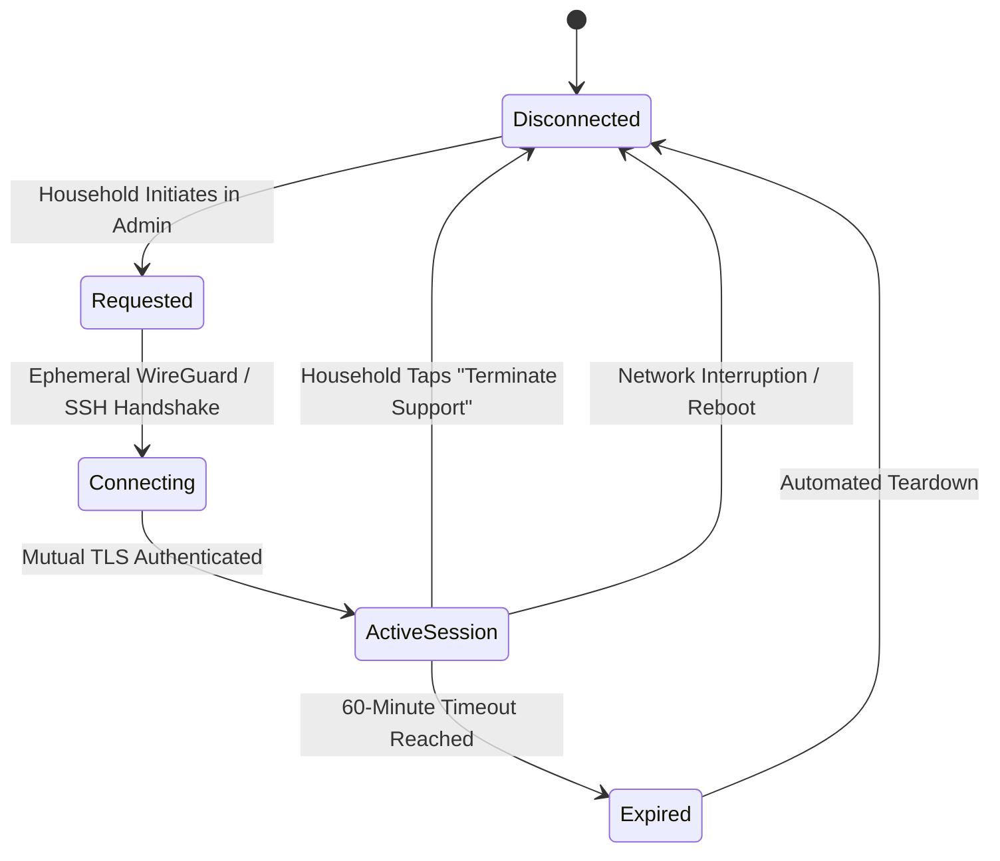

# FamilyBoard Remote Support Architecture & Security Model

> **Shipping status:** FamilyBoard 1.5 implements local diagnostics and a
> household-downloaded redacted support bundle. It does not ship a remote
> tunnel, public listener, vendor account, or persistent support credential.
> The session state machine below is a mandatory security contract for any
> future live-support implementation, not a claim that remote access is active.

This document outlines the privacy-first architecture, threat model, and operational boundaries for technical remote assistance on FamilyBoard smart appliances.

---

## 1. Core Architectural Axioms

1. **Zero Open Inbound Ports**: FamilyBoard appliances never open public inbound WAN ports, dynamic UPnP pinholes, or persistent backdoors.
2. **Explicit Opt-In Only**: No remote assistance session can exist without manual admin interaction on the physical touch kiosk or local LAN admin console.
3. **Strict Time Bounding**: All support sessions expire automatically after a hard maximum of 60 minutes.
4. **Immediate Household Revocability**: A single tap on the Admin console instantly kills any active tunnel and terminates all associated processes.
5. **No Access to Household Secrets**:
   - Private calendar event titles and descriptions are excluded from diagnostic outputs.
   - OAuth access and refresh tokens are stored in `0600` isolated files and never included in support bundles.
   - Photos stored in FotoCube are never transmitted to diagnostic bundles.
   - Admin password hashes and session keys remain strictly local.

---

## 2. Remote Support State Machine

---

## 3. Threat Model & Mitigations

| Threat Vector | Mitigation Strategy |
| :--- | :--- |
| **Persistent Vendor Access** | Remote sessions use ephemeral keys that expire upon teardown; no static SSH authorized keys exist on the appliance. |
| **Data Exfiltration** | Support bundles generated via `/admin/support/bundle` are scrubbed of personal calendar content, contacts, and credentials. |
| **Man-in-the-Middle (MITM)** | Tunnels are terminated via mutual TLS or authenticated WireGuard with pinned server public keys. |
| **Unauthorized LAN Pivoting** | The appliance firewall (`iptables` / `nftables`) confines incoming remote support traffic strictly to the loopback daemon port (`127.0.0.1:8080`), preventing access to other household LAN devices. |

---

## 4. Household Transparency & Audit Logging

Every interaction during a support session is recorded to the immutable local audit log:

- Timestamp of session initiation and termination
- Authorized technician identity or ticket number
- Diagnostic commands executed
- Configuration values inspected

These entries can be reviewed at any time by the household via the Admin console (`/admin?tab=audit`).
